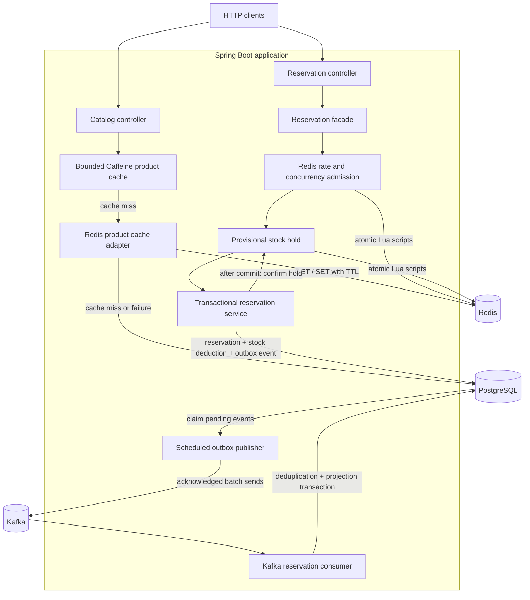
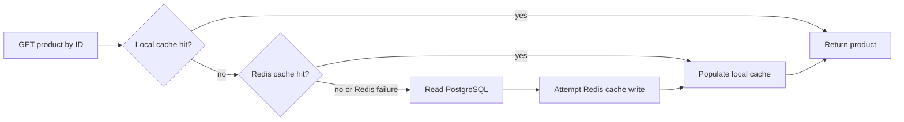
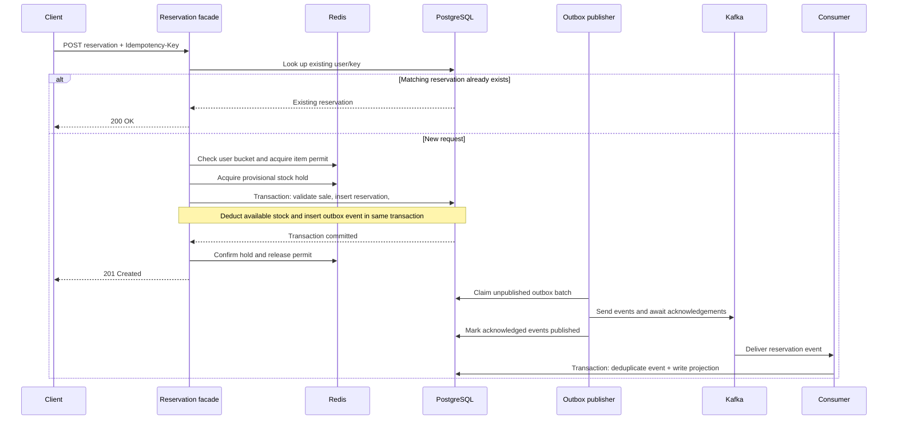
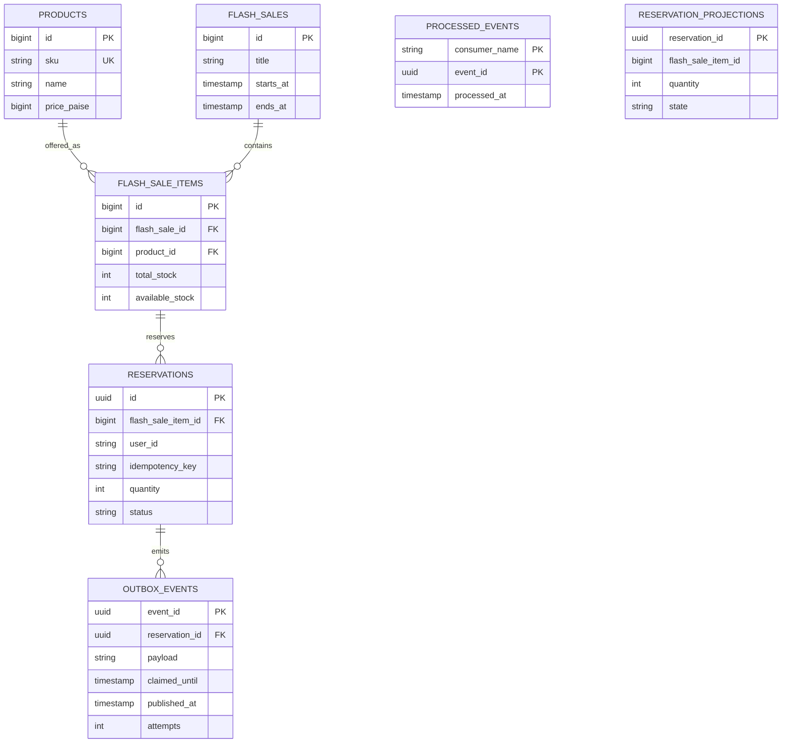

# FlashScale

A Java 21 / Spring Boot backend for flash-sale catalogs and inventory reservations. FlashScale combines local and Redis product caches, atomic Redis admission control, transactional PostgreSQL inventory updates, and a Kafka transactional-outbox pipeline.

The project demonstrates caching, concurrency control, idempotency, backpressure, and reliable asynchronous event delivery in one application.

> **Performance status:** one cached product endpoint delivered **57,383 reads/sec** for 60 seconds under continuous load on a local machine. The fixed 10,000-arrivals/sec test dropped scheduled requests. Neither zero-drop 10k/sec arrival handling nor 10k successful reservations/sec has been established. See [measured performance](#measured-performance).

## Contents

- [Architecture](#architecture)
- [Technology stack](#technology-stack)
- [Core concepts](#core-concepts)
- [Data model](#data-model)
- [Run locally](#run-locally)
- [API reference](#api-reference)
- [Configuration](#configuration)
- [Observability](#observability)
- [Tests and load testing](#tests-and-load-testing)
- [Measured performance](#measured-performance)
- [Failure handling and recovery](#failure-handling-and-recovery)
- [Current limitations](#current-limitations)
- [Project layout](#project-layout)

## Architecture



The API, scheduler, and Kafka listener run in the **same application process**. Redis provides a fast cache and admission layer; PostgreSQL remains the authoritative inventory and reservation store. Kafka carries events after the database transaction commits.

### Product read flow



### Reservation flow



The diagram shows the successful path. Admission, unavailable stock state, invalid sale windows, and database failures can end the request earlier; see [failure handling](#failure-handling-and-recovery).

## Technology stack

| Component | Version / implementation | Purpose |
|---|---|---|
| Runtime | Java 21 | Application runtime |
| Framework | Spring Boot 4.1.2, Spring MVC | HTTP API, validation, configuration |
| Database | PostgreSQL 17 | Authoritative catalog, inventory, reservations, events |
| Data access | Spring Data JPA + JDBC | Entity reads and explicit atomic SQL writes |
| Migrations | Flyway | Schema creation and demo catalog seed |
| Local cache | Caffeine | Bounded product cache and concurrent-load coalescing |
| Shared cache / admission | Redis 7.4 + Lua | Product cache, token buckets, permits, stock holds |
| Event broker | Apache Kafka 4.1.2 | Committed-reservation events |
| Telemetry | Actuator, Micrometer, Prometheus registry | Health and runtime metrics |
| Testing | JUnit, Mockito, k6 | Regression tests and load generation |
| Local infrastructure | Docker Compose | PostgreSQL, Redis, Kafka |

Dependency and container versions are defined in [pom.xml](pom.xml) and [compose.yml](compose.yml).

## Core concepts

### 1. Two-level cache and cache-aside reads

Individual product reads first check a per-instance Caffeine cache, then Redis, and finally PostgreSQL. A miss loads the product and attempts to populate Redis before returning it through the local cache.

- **Local bound:** at most 10,000 cached product entries per instance.
- **Local expiry:** five seconds after a value is written.
- **Redis expiry:** 60 seconds.
- **Miss coalescing:** concurrent local misses for the same product share one load per instance, limiting a cache stampede.
- **Failure fallback:** a Redis read or write failure does not prevent a PostgreSQL product read, though Redis timeouts can add latency.

The combined layers can serve product metadata that is roughly 65 seconds old. There is no explicit write-driven cache invalidation. Only individual product reads use this cache; product lists, sale details, and inventory responses follow the database path.

### 2. Rate limiting with a token bucket

Each user has a Redis token bucket. Tokens refill over time up to a maximum burst capacity, and a request consumes one token. The defaults allow a burst of **10** with **5 tokens/second** refill.

The Lua script reads, refills, and updates the bucket atomically using Redis server time. Requests without an available token receive `429 Too Many Requests`. The bucket is keyed by user across items; the API currently accepts that user ID from the request body.

### 3. Concurrency admission and backpressure

A separate Redis sorted set tracks in-flight permits for each sale item. The default is **100 concurrent permits per item**, each with a **30-second lease**. Expired permits are removed during acquisition, and request cleanup attempts to release its permit.

A permit caps concurrent admitted work; it is not a requests-per-second guarantee. At capacity, the API returns `429` rather than allowing unlimited reservation work to reach PostgreSQL. Leases allow abandoned permits to expire, so they are not a replacement for database correctness checks.

### 4. Provisional stock holds and atomic Lua scripts

Before the database transaction, a Lua script checks Redis stock and atomically records a temporary hold while decrementing provisional availability. On a newly committed reservation, the facade confirms the hold without refunding stock. A concurrent idempotent replay releases its extra hold. On a service failure, cleanup attempts to release the hold.

Lua makes each script's Redis operations atomic. It does **not** make Redis and PostgreSQL one transaction. Redis stock is an admission estimate; PostgreSQL decides whether inventory can actually be reserved.

An expired pending hold is ambiguous: the database might have committed before the application failed. The gate retains that hold and returns `503` until reconciliation, instead of automatically refunding potentially sold stock.

### 5. Atomic database inventory updates

The reservation service uses one PostgreSQL transaction to:

1. Validate the sale item and active sale window.
2. Insert the reservation if the user/key pair does not already exist.
3. Conditionally decrement stock only when enough inventory remains and the sale is active.
4. Insert the outbox event.

Failure rolls back the database work. The conditional stock update and database constraints protect inventory independently of Redis. Updates to the same item's row still contend in PostgreSQL; adding Redis does not remove that serialization point.

For isolated fresh benchmark items, the correctness check is:

```text
initial stock = remaining stock + sum(committed reservation quantities)
remaining stock >= 0
```

### 6. Idempotency and safe retries

The unique database key is **`(user_id, idempotency_key)`**. Retrying the same user, key, item, and quantity returns the original reservation without deducting stock again. Reusing that user/key pair for a different item or quantity returns `409 Conflict`.

The facade checks for a replay before Redis admission, and the transactional service also handles concurrent insert conflicts. Clients should retain the same key when retrying an uncertain outcome. A key must be nonblank and at most 128 characters.

### 7. Transactional outbox and at-least-once publication

Writing the reservation and its event in the same PostgreSQL transaction avoids a reservation committing without a corresponding durable outbox record.

The scheduled publisher claims up to **500** unpublished events with `FOR UPDATE SKIP LOCKED`, assigns a **30-second claim lease**, dispatches a bounded batch of Kafka sends, and waits for acknowledgements within a shared deadline. It batches database publication markers for acknowledged events. The configured delay between completed polls is **10 ms**.

A crash after Kafka accepts an event but before its database marker is saved can cause publication again. Delivery is therefore **at least once**. Producer idempotence helps Kafka producer retries, but does not make the database-to-Kafka workflow exactly once.

### 8. Consumer deduplication and eventual consistency

The consumer transaction inserts `(consumer_name, event_id)` into `processed_events` and writes the reservation projection. If the event ID was already processed, it returns without applying the projection again. Listener offsets are acknowledged per successfully processed record.

The reservation API returns after the authoritative database commit; it does not wait for the projection. This makes the projection **eventually consistent**. The default topic has three partitions and one replica, and the configured error handler retries indefinitely with a one-second backoff. There is no configured dead-letter topic.

## Data model



The diagram shows selected columns and the declared catalog/reservation/outbox foreign keys. Projection identifiers are stored as values without declared foreign keys. Prices use integer **paise**, avoiding floating-point currency calculations. The schema permits several reservation statuses, but the current API creates `RESERVED` records; confirmation, payment, cancellation, and expiration workflows are not implemented.

Schema definitions live in [Flyway migrations](src/main/resources/db/migrations).

## Run locally

### Prerequisites

- Java 21 and a running Docker installation with Compose.
- The included Maven wrapper; a separate Maven installation is unnecessary.
- Python 3 and k6 for optional benchmarks.

### Start the infrastructure and API

```bash
git clone https://github.com/Gautam-aman/FlashScale.git
cd FlashScale
docker compose up -d db redis kafka
./mvnw spring-boot:run
```

Flyway applies migrations and seeds a demo catalog at startup. The seeded sale lasts 30 days from its initial migration; create a new active sale in the database if it has expired. The current API has no catalog-write endpoints.

| Service | Local address |
|---|---|
| API | `http://localhost:8080` |
| PostgreSQL | `localhost:5433` |
| Redis | `localhost:6379` |
| Kafka | `localhost:9092` |

```bash
curl http://localhost:8080/actuator/health
curl http://localhost:8080/api/v1/products/1
curl http://localhost:8080/api/v1/sales/1/items
```

### Initialize inventory before reservations

Find an active sale item's `flashSaleItemId` using the sale-items endpoint. Stop **all API instances and reservation clients** before initializing or reconciling that item's Redis inventory:

```bash
bash scripts/reconcile-stock.sh <flash-sale-item-id>
```

Type `STOPPED` at the prompt, then restart the API. The script copies PostgreSQL availability into Redis and clears that item's pending holds. Running it during reservation traffic can overwrite valid holds and corrupt the admission estimate.

New items require initialization. Missing Redis stock and expired pending holds return `503` until reconciled. The benchmark baseline runner initializes only its own fresh items with `SET NX`; it does not reconcile existing live inventory.

### Build a runnable JAR

```bash
./mvnw verify
java -jar target/FlashScale-0.0.1-SNAPSHOT.jar
```

The verification command requires the configured infrastructure for integration tests. To stop the local infrastructure while retaining its named volumes:

```bash
docker compose stop
```

## API reference

Catalog routes are available at both the root path and `/api/v1`. Reservation routes use `/api/v1`.

| Method | Path | Behavior |
|---|---|---|
| GET | `/api/v1/products` | List products from PostgreSQL |
| GET | `/api/v1/products/{id}` | Read through local and Redis caches |
| GET | `/api/v1/sales` | List sales with computed time-based status |
| GET | `/api/v1/sales/{id}` | Get a sale |
| GET | `/api/v1/sales/{id}/items` | Get sale items and current database inventory |
| POST | `/api/v1/reservations` | Reserve inventory with an idempotency key |
| GET | `/api/v1/reservations/{id}` | Get the authoritative reservation |
| GET | `/api/ping` | Basic ping |

### Create a reservation

Use an initialized item from an active sale; replace `1` with its sale-item ID.

```bash
curl -i -X POST http://localhost:8080/api/v1/reservations \
  -H 'Content-Type: application/json' \
  -H 'Idempotency-Key: order-123' \
  -d '{"flashSaleItemId":1,"userId":"user-1","quantity":1}'
```

Example response body:

```json
{
  "reservationId": "d9de4cb8-8ef5-4e31-9101-70cad552531f",
  "flashSaleItemId": 1,
  "userId": "user-1",
  "quantity": 1,
  "status": "RESERVED"
}
```

`flashSaleItemId` must be positive, `userId` must be nonblank and at most 100 characters, and `quantity` must be between 1 and 5. A product ID and a sale-item ID identify different records and are not interchangeable.

| Status | Meaning |
|---|---|
| `201 Created` | A new reservation committed |
| `200 OK` | Matching idempotent replay, or successful GET |
| `400 Bad Request` | Invalid body, missing header, or invalid idempotency key |
| `404 Not Found` | Requested resource does not exist |
| `409 Conflict` | Insufficient inventory, inactive sale, or mismatched key reuse |
| `429 Too Many Requests` | User bucket or per-item concurrency limit reached |
| `503 Service Unavailable` | Redis admission unavailable or inventory state needs reconciliation |

An error during a distributed operation does not always prove that no database commit occurred. Retry an uncertain reservation outcome with the **same** user/key and inspect the reservation result.

## Configuration

Defaults are in [application.yaml](src/main/resources/application.yaml). Spring Boot environment variables and command-line properties can override configuration.

| Environment variable | Default |
|---|---|
| `DB_HOST` | `localhost` |
| `DB_PORT` | `5433` |
| `DB_NAME` | `flashscale` |
| `DB_USER` | `flashscale` |
| `DB_PASSWORD` | `flashscale_dev` |
| `REDIS_HOST` | `localhost` |
| `REDIS_PORT` | `6379` |
| `KAFKA_BOOTSTRAP_SERVERS` | `localhost:9092` |

| Application property | Default | Meaning |
|---|---|---|
| `server.port` | `8080` | HTTP listener |
| `spring.datasource.hikari.maximum-pool-size` | `10` | Maximum database connections per instance |
| `flashscale.cache.local-max-products` | `10000` | Local product entry bound |
| `flashscale.cache.local-ttl-seconds` | `5` | Local product expiry |
| `flashscale.admission.max-inflight` | `100` | Permits per sale item |
| `flashscale.admission.permit-lease-ms` | `30000` | Permit lease |
| `flashscale.admission.user-burst` | `10` | Token-bucket capacity |
| `flashscale.admission.user-refill-per-second` | `5` | Tokens replenished per second |
| `flashscale.stock.lease-ms` | `30000` | Pending stock-hold lease |
| `flashscale.outbox.batch-size` | `500` | Maximum events claimed per poll |
| `flashscale.outbox.poll-delay-ms` | `10` | Delay after a completed publisher poll |
| `flashscale.kafka.topic` | `flashscale.reservations.v1` | Reservation event topic |

The shared product TTL is currently a 60-second constant in `CachedProductService`. Kafka uses `acks=all`, producer idempotence, a 5 ms linger, a 64 KiB batch setting, and a 10-second delivery timeout. These settings do not constitute measured event throughput or broker redundancy.

Example port override:

```bash
java -jar target/FlashScale-0.0.1-SNAPSHOT.jar --server.port=8081
```

## Observability

| Endpoint | Purpose |
|---|---|
| `/actuator/health` | Database, Redis, and application health |
| `/actuator/info` | Available application information |
| `/actuator/metrics` | Discover runtime metrics |
| `/actuator/metrics/hikaricp.connections.active` | Active database pool connections |
| `/actuator/metrics/hikaricp.connections.pending` | Threads waiting for a database connection |
| `/actuator/prometheus` | Prometheus scrape output |

Health being `UP` does not establish Kafka publication progress, inventory reconciliation status, or the target throughput. Outbox failures are logged; dedicated recovery monitoring classes are currently placeholders.

When investigating capacity, collect application CPU/GC profiles, Hikari active/pending counts, PostgreSQL lock waits, outbox backlog/age, Kafka consumer lag, and load-generator CPU/memory. See the [benchmark methodology](benchmarks/README.md#bottleneck-evidence).

## Tests and load testing

### Regression and integration tests

```bash
docker compose up -d db redis kafka
./mvnw verify
```

The last verified build passed **22 tests**. Coverage includes catalog reads, transactional reservation behavior, Redis admission and stock gates, facade cleanup, concurrent cache misses, failed cache loads, and publisher acknowledgement handling. Publisher unit tests mock Kafka acknowledgements; they do not measure end-to-end Kafka throughput. Integration tests use the configured infrastructure.

### Fixed-arrival product capacity test

Start the API on port 8081, then run:

```bash
python3 benchmarks/run-capacity.py \
  --base-url http://localhost:8081 \
  --rate 10000 --duration 120 --vus 1000 --repeats 3
```

The runner warms the endpoint, retains successful and failed runs in a unique results directory, and exits unsuccessfully if any measured repetition fails. Acceptance requires:

- More than 99.9% expected responses and fewer than 0.1% HTTP failures.
- Zero dropped scheduled iterations.
- Achieved HTTP RPS at least 99% of requested RPS.
- p95 latency below 100 ms and p99 below 250 ms.

This is an **open-loop** workload: requests are scheduled at a fixed rate even if responses slow down. Dropped iterations represent scheduled work the generator could not start; they must not disappear from a capacity claim.

### Continuous-load throughput test

```bash
k6 run -e BASE_URL=http://localhost:8081 -e MODE=product -e RATE=10000 \
  -e VUS=50 -e DURATION=60s load-tests/throughput.js
```

This is a **closed-loop** workload: 50 clients issue their next request after the previous one finishes. `RATE` sets the throughput acceptance threshold; it does not schedule 10,000 arrivals/sec in this test. It measures delivered throughput, not burst acceptance at a fixed arrival rate.

### Reservation and baseline workloads

```bash
python3 benchmarks/run-baseline.py --label redis --base-url http://localhost:8081
```

This runs the documented read/reservation matrix and creates real database reservations. The runner provisions and initializes fresh benchmark items and checks inventory invariants. Historical PostgreSQL baseline results predate the current Redis/Kafka path; see [benchmark instructions](benchmarks/README.md) before making comparisons.

`load-tests/baseline.js` also supports `product`, `sale_items`, `reserve`, and `soldout` modes. `load-tests/reservations-10k.js` defaults to **10,000 total iterations**, not 10,000 requests per second. Rejections and sold-out responses must be distinguished from successfully committed reservations.

## Measured performance

All results below are local measurements on a **Mac14,2 with 8 CPUs and 8 GiB RAM**, with k6, the application, and Docker infrastructure sharing one machine. The workload repeatedly reads **product ID 1**; it does not represent an uncached catalog or a production traffic mix.

| Final-build workload | Duration | Delivered RPS | HTTP failures | Dropped scheduled requests | p95 | p99 |
|---|---|---|---|---|---|---|
| 50 continuous clients | 60 s | **57,382.72** | 0 | Not applicable to fixed-arrival acceptance | 2.146 ms | 4.265 ms |
| 10,000 fixed arrivals/sec, 200 VUs | 120 s | **9,937.23** | 0 | **7,414** | 0.227 ms | 6.298 ms |

The continuous-load run passed its throughput and latency criteria. The fixed-arrival run **failed** the zero-drop requirement; the source of missed arrivals was not established. These results do not prove zero-drop 10k/sec handling, 10k successful reservations/sec, long-term sustainable capacity, or the original million-RPS ambition.

Historical PostgreSQL-only runs passed all repetitions at 500 product reads/sec and 100 reservations/sec. Those rates were the highest passing rates in that matrix, **not measured maximum capacity**; they do not establish current reservation capacity.

Evidence:

- [Current capacity report, raw summaries, and logs](benchmarks/results/10k-capacity/report.md)
- [Environment, source diff, and final JAR checksum](benchmarks/results/10k-capacity/environment.json)
- [Historical PostgreSQL baseline](benchmarks/results/20261104T105147Z-16572f/report.md)

## Failure handling and recovery

| Condition | Current behavior |
|---|---|
| Product cache unavailable | Attempt PostgreSQL fallback; local hits still work |
| Redis admission unavailable | Reservation admission returns `503` |
| User or item admission exhausted | Return `429` |
| Missing stock key or expired pending hold | Return `503`; reconcile offline |
| Stock exhausted or sale inactive | Return `409` when detected |
| Database transaction fails | Database changes roll back; facade attempts hold/permit cleanup |
| Crash after database commit | Reservation/outbox remain durable; Redis hold can require reconciliation |
| Kafka send fails or outcome is uncertain | Leave event unpublished for a later leased retry |
| Crash after Kafka acknowledgement, before publication marker | Duplicate publication is possible |
| Duplicate event delivered | Consumer event-ID deduplication prevents a repeated projection effect |
| Persistent consumer processing failure | Retry indefinitely; affected partition progress can stall |

To recover inventory, stop all API instances and clients, run `scripts/reconcile-stock.sh` for the affected item, and restart traffic. Do not refund uncertain expired holds automatically: PostgreSQL may already have committed the reservation.

Redis admission keys and PostgreSQL inventory are not a distributed atomic transaction. Availability can degrade conservatively after partial failures, and there is no automatic online stock-recovery workflow.

## Current limitations

- **Business scope:** no authentication/authorization, trusted user identity, payment integration, confirmation/cancellation endpoints, or automatic reservation expiry. A stock-hold lease is not a business reservation expiry.
- **Read freshness:** product metadata uses TTL-based caches; inventory lists come from PostgreSQL. Catalog list endpoints are currently unpaginated.
- **Write scaling:** every reservation still performs synchronous database work. A hot item's inventory row remains a contention point, and each instance has a 10-connection pool by default.
- **Deployment:** Compose supplies local infrastructure, not a replicated production deployment. No load balancer, autoscaling, sharding, or independently deployed API/worker roles are provided.
- **Resilience:** Kafka's default topic replication factor is one; there is no dead-letter workflow, automatic inventory reconciliation, or implemented custom recovery monitor. Redis stock scripts use multiple related keys without a Redis Cluster hash-tag strategy.
- **Security and operations:** local credentials are development defaults; the API and Actuator endpoints have no application authentication configured. Production needs access controls, secret management, TLS, backups, and a defined recovery process.
- **Evidence:** varied-product workloads, distributed generators, current reservation limits, event pipeline capacity, failover, and long soak runs remain unmeasured.

The next capacity milestone is a repeatable deployment test with an explicit read/write mix, successful-reservation target, latency SLO, and independent generator telemetry. Read-cache throughput alone cannot establish inventory-write capacity.

## Project layout

```text
src/main/java/com/example/FlashScale/
  admission/      Token buckets, concurrency permits, Redis stock gate, facade
  cache/          Caffeine + Redis product cache
  controller/     Catalog and ping endpoints
  dto/            Catalog responses and reservation event payload
  reservation/    Reservation HTTP API, service, JPA and JDBC access
  kafka/          Outbox persistence/publishing, consumer and projection
  recovery/       Recovery-monitoring placeholders
  Models/         Catalog entities
  Repository/     Catalog repositories
src/main/resources/
  application.yaml  Active application defaults
  db/migrations/    Flyway schema and seed migrations
  redis/            Atomic Lua scripts
src/test/           Regression and integration tests
scripts/            Offline inventory reconciliation
load-tests/         k6 fixed-arrival and continuous-load workloads
benchmarks/         Python runners, methodology, reports and raw evidence
compose.yml         Local PostgreSQL, Redis and Kafka services
pom.xml             Maven dependencies and build configuration
```

Some role/profile-named resource files and Java configuration classes are empty placeholders; they do not currently provide separate deployment roles. The active configuration is `application.yaml`.
