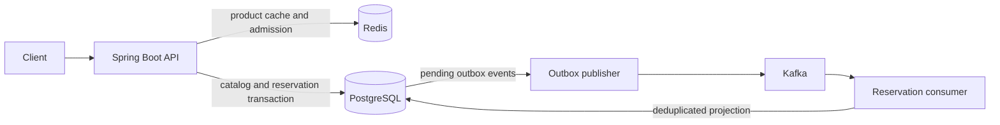

# FlashScale

FlashScale is a Java and Spring Boot backend for flash-sale catalogs and inventory reservations. It combines Redis admission control with transactional PostgreSQL inventory updates and publishes committed reservations through a Kafka outbox.

## Architecture



- **Catalog:** PostgreSQL stores products, sales, and sale items. Individual product reads use a 60-second Redis cache and fall back to PostgreSQL if the cache fails.
- **Admission and stock:** Redis limits concurrent and per-user requests and uses atomic scripts to place provisional stock holds. PostgreSQL remains the authoritative inventory store.
- **Reservations:** The service validates the sale window, inserts a reservation, deducts stock, and records an outbox event in one database transaction. Idempotency keys make retries safe for the same user and request.
- **Events:** A scheduled publisher claims outbox rows and sends them to Kafka. A consumer records processed event IDs and writes a reservation projection. Publication can be retried, so the consumer handles duplicate events.

The API, publisher, and consumer are components of the same application. Flyway manages the schema and seeds a demo catalog.

## Requirements

- Java 21
- Docker and Docker Compose
- The included Maven wrapper (no separate Maven installation required)
- Python 3 and [k6](https://k6.io/) for the optional benchmarks

## Run locally

Start the infrastructure, then start the application from the repository root:

```bash
docker compose up -d db redis kafka
./mvnw spring-boot:run
```

The API listens on `http://localhost:8080`. PostgreSQL, Redis, and Kafka are exposed locally on ports 5433, 6379, and 9092 respectively. Flyway creates the tables and demo data on first startup. The seeded sale lasts 30 days from the initial migration; create an active sale if it has expired.

Before accepting reservations for an item, initialize its Redis stock from PostgreSQL. **Stop all API instances and reservation clients first**, then run the reconciliation script and follow its confirmation prompt:

```bash
bash scripts/reconcile-stock.sh <flash-sale-item-id>
```

Start the application again afterward. Repeat this process for new items or when inventory requires reconciliation. Missing Redis stock or expired pending holds cause reservation requests to return HTTP 503. Holds are not automatically refunded after expiry because the database transaction may already have committed. See [benchmark documentation](benchmarks/README.md#stock-gate-reconciliation) for details.

## API

Catalog routes are available both at the root and under `/api/v1`:

| Method | Path | Description |
| --- | --- | --- |
| GET | `/api/v1/products` | List products |
| GET | `/api/v1/products/{id}` | Get a product |
| GET | `/api/v1/sales` | List sales |
| GET | `/api/v1/sales/{id}` | Get a sale |
| GET | `/api/v1/sales/{id}/items` | List items in a sale |
| POST | `/api/v1/reservations` | Reserve stock |
| GET | `/api/v1/reservations/{id}` | Get a reservation |
| GET | `/api/ping` | Basic ping |

For example, after reconciling an active sale item:

```bash
curl http://localhost:8080/api/v1/sales/1/items
curl -X POST http://localhost:8080/api/v1/reservations \
  -H 'Content-Type: application/json' \
  -H 'Idempotency-Key: order-123' \
  -d '{"flashSaleItemId":1,"userId":"user-1","quantity":1}'
```

Quantity must be between 1 and 5. A new reservation returns `201`; replaying the same request with the same key and user returns `200`. Reusing that key with a different item or quantity returns `409`. Admission limits can return `429`, while unavailable Redis admission or stock state can return `503`.

## Configuration and observability

Defaults are in [application.yaml](src/main/resources/application.yaml). The infrastructure connection settings can be overridden with `DB_HOST`, `DB_PORT`, `DB_NAME`, `DB_USER`, `DB_PASSWORD`, `REDIS_HOST`, `REDIS_PORT`, and `KAFKA_BOOTSTRAP_SERVERS`. The Compose credentials are for local development.

Spring Boot Actuator exposes `/actuator/health`, `/actuator/info`, `/actuator/metrics`, and `/actuator/prometheus`. Admission limits, stock lease duration, Kafka topic, and outbox polling interval are configured under `flashscale` in the same YAML file.

## Tests and benchmarks

```bash
./mvnw test
```

Integration tests use the configured infrastructure; start the Compose services first. Load-test scripts live in `load-tests/`, and the benchmark runner, methodology, and reconciliation instructions are in [benchmarks/README.md](benchmarks/README.md). Benchmark runs create real reservations in the configured database.

## Project layout

```text
src/main/java/com/example/FlashScale/
  admission/      Redis admission control and provisional stock holds
  cache/          Product cache
  controller/     Catalog and ping endpoints
  reservation/    Reservation API and transactional service
  kafka/          Outbox publisher and reservation consumer
  Models/         Catalog entities
  Repository/     Catalog repositories
src/main/resources/db/migrations/  Flyway schema and demo data
scripts/          Inventory reconciliation
load-tests/       k6 workloads
benchmarks/       Benchmark runner and reports
```
